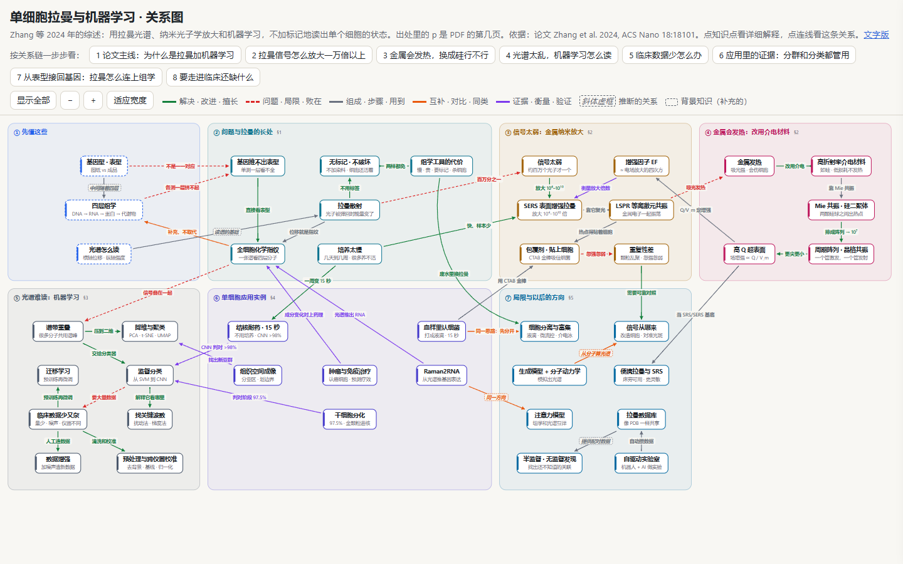
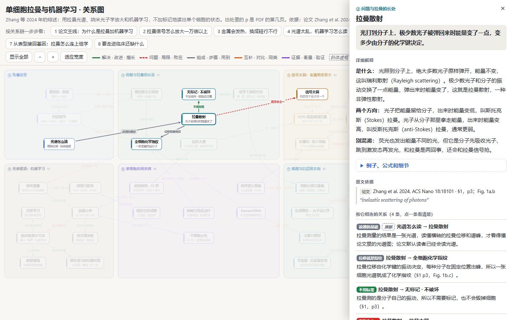
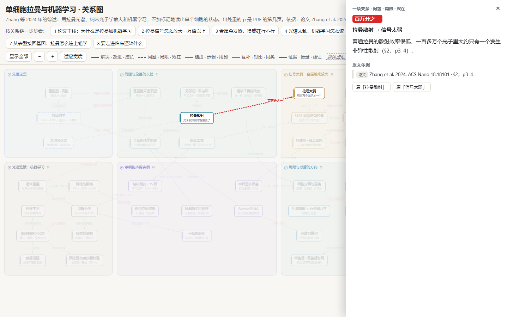
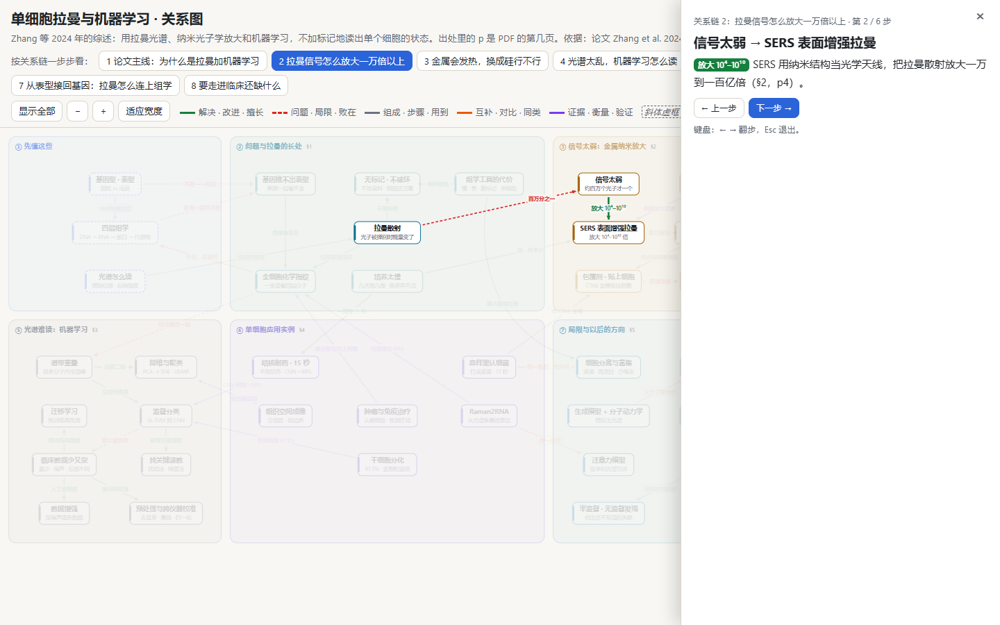
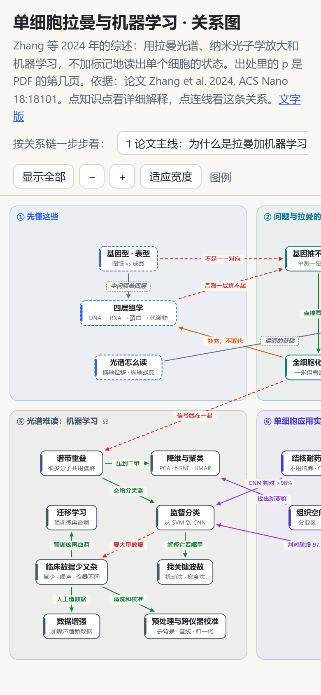
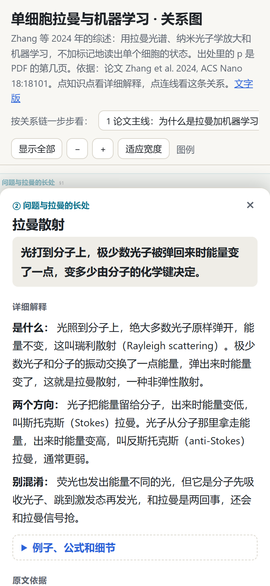
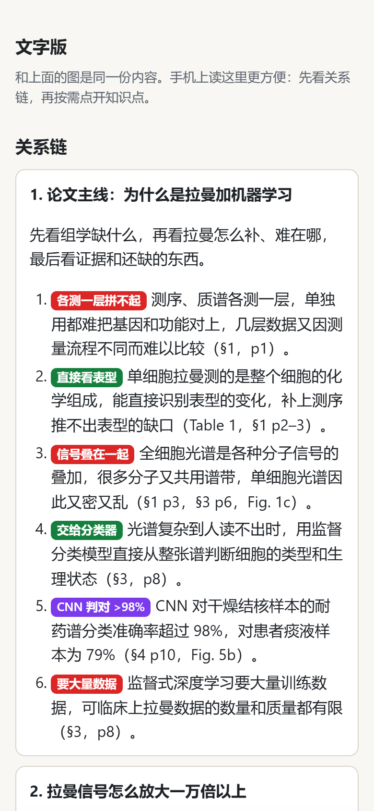

# 图文教程 · Illustrated walkthrough

[← 返回 README · Back to README](../README.md)

这份教程跟着一次真实的运行，一步一步看 knowledge-map 怎么用。2026 年 10 月，我们用它给一篇 17 页的英文综述画了关系图：Zhang et al., *From Genotype to Phenotype: Raman Spectroscopy and Machine Learning for Label-Free Single-Cell Analysis*（ACS Nano 2024）。截图里的 HTML 是用这次运行产出的数据文件、由现在的版本重新生成的，内容和当时一样。

This walkthrough follows one real run step by step. In October 2026 we used knowledge-map to map a 17-page review paper: Zhang et al., *From Genotype to Phenotype: Raman Spectroscopy and Machine Learning for Label-Free Single-Cell Analysis* (ACS Nano 2024). The HTML in the screenshots was rebuilt by the current version from the data file produced in that run, so the content is the same. The page interface is in Chinese.

## 1. 提出请求 · Make the request

在 Claude Code 里，把论文 PDF 作为附件，再写一句话。这次实际的请求是：

In Claude Code, attach the paper PDF and write one sentence. This is the request actually used:

> @"Zhang et al. - 2024 - From Genotype to Phenotype Raman Spectroscopy and Machine Learning for Label-Free Single-Cell Analy.pdf" 给这篇论文画关系图 注意 这不是我们领域的论文 不要把这篇论文的知识纳入我们项目的知识库 只是测试这个 skill

请求里说了这篇论文和项目无关，所以图放在论文原件旁边新建的文件夹里，没有进项目文件夹，论文的内容也没有写进项目的知识库。

In English the request says: "Draw a knowledge map of this paper. Note: this paper is outside our field. Don't add its content to our project's knowledge base. This is only a test of the skill." Because the request said the paper was unrelated to the project, the map went into a new folder next to the original PDF instead of the project folder, and none of the paper's content was added to the project's knowledge base.

## 2. AI 做了什么 · What the AI did

| 项目 · Item | 中文 | English |
|---|---|---|
| 材料 · Material | 读完 17 页论文 | Read the whole 17-page paper |
| 知识点 · Ideas | 42 个，分 7 个区 | 42 ideas in 7 zones |
| 关系 · Relations | 45 条：解决或改进 17 条、组成 11 条、问题 7 条、证据 6 条、互补 4 条；其中 5 条是推断的 | 45 relations: 17 solve or improve, 11 part of, 7 problem, 6 evidence, 4 complementary; 5 of them are inferred |
| 关系链 · Chains | 8 条，例如“论文主线：为什么是拉曼加机器学习” | 8 chains, such as "the paper's main line: why Raman plus machine learning" |
| 检查 · Checks | 用 `build.py` 生成 HTML，用 `check.py` 在浏览器里查版面 | Built the HTML with `build.py` and checked the layout in a browser with `check.py` |
| 用量 · Usage | 48 次模型调用，57 分钟，按 API 标价折算约 13 美元 | 48 model calls, 57 minutes, about $13 at API list prices |

## 3. 得到的文件 · The output files

```text
Zhang2024_Raman_kmap/
├── Zhang2024_Raman_ML.kmap.toml   数据文件：图的全部内容 · data file: all of the map's content
└── Zhang2024_Raman_ML.html        成品：用浏览器打开 · the map: open it in a browser
```

## 4. 打开图 · Open the map



打开时，整张图铺满窗口。最上面是标题、一句话介绍和每条关系链的按钮；下面一行是“显示全部”、缩放、“适应宽度”和图例。7 个分区按论文的结构排，从“① 先懂这些”到“⑦ 局限与以后的方向”。线的颜色表示关系类型，虚线框的卡片是论文默认读者已经会的背景知识。

When the page opens, the whole map fits the window. At the top are the title, a one-line introduction and one button per relation chain. The next row has 显示全部 (Show all), zoom, 适应宽度 (Fit width) and the legend. The seven zones follow the paper's structure, from ① background knowledge to ⑦ limitations and future directions. Line colors show the relation type, and dashed cards are background knowledge the paper assumes its readers have.

## 5. 点一个知识点 · Click an idea



点“拉曼散射”：只有和它相连的 4 条关系保持高亮，别的都变淡。右边的面板从上到下是：所在分区、一句话定义、详细解释（是什么、两个方向、别混淆）、可以展开的“例子、公式和细节”、原文依据（页码和原文引文），最后是和它相连的关系，点一条就跳到那条关系。

Clicking 拉曼散射 (Raman scattering) keeps only its four relations highlighted and fades everything else. The side panel shows, from top to bottom: the zone, a one-sentence definition, the detailed explanation (what it is, the two directions, what not to confuse it with), an expandable section of examples, formulas and details, the source (page numbers and the quoted words), and finally the connected relations. Click one to jump to that relation.

## 6. 点一条关系 · Click a relation



点“拉曼散射”到“信号太弱”那条红色虚线：面板显示关系的类型（问题·局限·败在）、线上的标签“百万分之一”、这条关系的解释和出处（§2，p3–4）。下面两个按钮可以跳到两端的知识点。

Clicking the red dashed line from 拉曼散射 to 信号太弱 (signal too weak) opens the relation: its type (problem, limitation, failure), its label 百万分之一 ("one in a million"), the explanation and the source (§2, p3–4). The two buttons below jump to the ideas at either end.

## 7. 按关系链一步步看 · Step through a relation chain



点页头的“2 拉曼信号怎么放大一万倍以上”，图会一步一步地讲：走过的步留着，当前这一步加粗。截图是 6 步里的第 2 步“信号太弱 → SERS 表面增强拉曼”。点“下一步”或按键盘的 ← → 翻步，按 Esc 退出。

Clicking chain 2 at the top, 拉曼信号怎么放大一万倍以上 ("how Raman signals get amplified more than ten-thousand-fold"), walks through it one step at a time: past steps stay lit and the current one is bold. The screenshot shows step 2 of 6, 信号太弱 → SERS (surface-enhanced Raman). Use 下一步 (Next) or the ← → keys to move, and Esc to leave the chain.

## 8. 在手机上看 · On a phone

<p>



</p>

左：手机上的图可以左右拖动。中：点一个知识点，解释从底部面板升起来。右：文字版把同样的内容按关系链和知识点排成一列，手机上读起来更方便。

Left: on a phone the map can be dragged sideways. Middle: tapping an idea raises its explanation in a bottom panel. Right: the text version lists the same content as chains and ideas in one column, which is easier to read on a phone.

## 9. 改图 · Edit the map

图的内容都在数据文件里。下面是“拉曼散射”这个知识点在真实数据文件里的样子：

All of the map's content is in the data file. This is the 拉曼散射 idea as it appears in the real data file:

```toml
[[nodes]]
id = "raman"
zone = "why"
pos = [1, 1]
title = "拉曼散射"
sub = "光子被弹回时能量变了"
one = "光打到分子上，极少数光子被弹回来时能量变了一点，变多少由分子的化学键决定。"
detail = '''
**是什么：** 光照到分子上，绝大多数光子原样弹开，能量不变，这叫瑞利散射（Rayleigh scattering）。极少数光子和分子的振动交换了一点能量，弹出来时能量变了，这就是拉曼散射，一种非弹性散射。

**两个方向：** 光子把能量留给分子，出来时能量变低，叫斯托克斯（Stokes）拉曼。光子从分子那里拿走能量，出来时能量变高，叫反斯托克斯（anti-Stokes）拉曼，通常更弱。

**别混淆：** 荧光也发出能量不同的光，但它是分子先吸收光子、跳到激发态再发光，和拉曼是两回事，还会和拉曼信号抢。
'''
more = '''
拉曼位移就是入射光子和散射光子的能量差，论文 Fig. 1b 写作：

$$\Delta E = h\,\Delta\upsilon$$

$\Delta E$ 是能量差，$h$ 是普朗克常数，$\Delta\upsilon$ 是两种光的频率差。论文 Fig. 3c 的例子：用 632.8 nm 的激光照胡萝卜素，它 1154 cm⁻¹ 的拉曼峰落在约 683 nm。
'''
src = [
  { s = "P", loc = "§1，p3；Fig. 1a,b", quote = "inelastic scattering of photons" },
]
```

`one` 是一句话定义，`detail` 是详细解释，`more` 是默认收起的部分，`src` 是出处和原文引文。公式用 LaTeX 写。改完以后重新生成，`--text` 给原文 PDF，用来核对每条引文。下面是用现在的版本重新生成这张图时的真实输出：

`one` is the one-sentence definition, `detail` the detailed explanation, `more` the part that starts collapsed, and `src` the source with the quoted words. Formulas are written in LaTeX. After editing, rebuild the map; `--text` takes the original PDF and is used to check every quote. This is the real output of rebuilding this map with the current version:

```text
$ python build.py Zhang2024_Raman_ML.kmap.toml --text "Zhang et al. - 2024 - From Genotype to Phenotype ….pdf"
已生成 Zhang2024_Raman_ML.html：42 个节点，45 条关系，8 条关系链，画布 2250.0×958.0。
警告：关系 39 的 bend 是 150，超过 ±120，线会绕大圈。挪开挡路的节点，或者重排分区。
警告：这是论文图，但没有一个节点或关系标 evidence。关键结果标“实测”，计算或仿真的值标“模拟”，作者提出、还没做出来的标“设想”。
内容核对没有错误。下一步运行 check.py 查版面。
```

两条警告来自后来加进 skill 的检查：这张图做得早，当时还没有这两条规则。最后一行说明内容核对没有错误，每条引文都在 PDF 原文里找到了。也可以不自己改文件，直接告诉 AI 要改什么。

The two warnings come from checks added to the skill later: this map was made before those rules existed. One warns that a curved line bends too far, the other that no result is tagged as measured, simulated or proposed. The last line says the content check found no errors, so every quote was found in the PDF. You can also skip editing the file yourself and just tell the AI what to change.

## 另一个真实案例：一门课的 7 张周图 · Another real case: 7 weekly course maps

一门课程的第 1 到 7 周，每周做了一张图，材料是那一周的课件、课堂 slides、录播字幕和 Notebook。7 张图由 7 个子任务同时做，每张 35 到 45 个知识点、42 到 56 条关系。用时和用量见 README 的“AI 用量”一节。这些图用的是课程的内部材料，所以这里不放截图。

For weeks 1 to 7 of one course, one map was made per week from that week's slides, in-class slides, lecture transcript and notebooks. Seven subagents made the seven maps at the same time, with 35–45 ideas and 42–56 relations each. Time and usage are in the AI usage section of the README. These maps use the course's internal materials, so they are not shown here.
